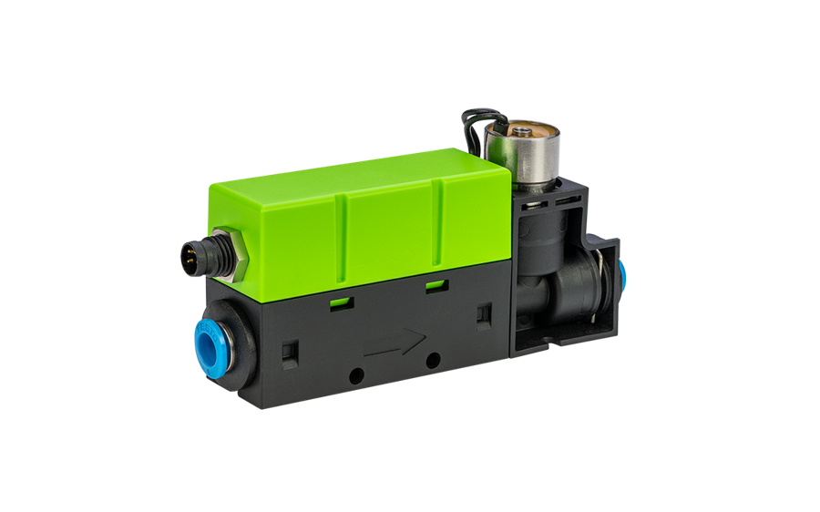
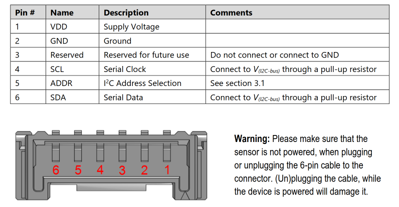

# Python I2C Driver for Sensirion SFX6XXX

This repository contains the Python driver to communicate with a Sensirion sensor of the SFX6XXX family over I2C.

Click [here](https://sensirion.com/sfc6000) to learn more about the Sensirion SFX6XXX sensor family.

## Supported sensor types

| Sensor name   | I²C Addresses  |
| ------------- | -------------- |
|[SFC6000](https://sensirion.com/products/catalog/SFC6000/)| **0x24**, 0x23, 0x22, 0x21, 0x20, 0x42, 0x41|
|[SFC6000D-5SLM](https://sensirion.com/products/catalog/SFC6000D-5slm/)| **0x24**, 0x23, 0x22, 0x21, 0x20, 0x42, 0x41|
|[SFC6000D-50SLM](https://sensirion.com/products/catalog/SFC6000D-50slm/)| **0x24**, 0x23, 0x22, 0x21, 0x20, 0x42, 0x41|
|[SFC6000D-20SLM](https://sensirion.com/products/catalog/SFC6000D-20slm/)| **0x24**, 0x23, 0x22, 0x21, 0x20, 0x42, 0x41|
|[SFM6000](https://sensirion.com/products/catalog/SFM6000)| **0x24**, 0x23, 0x22, 0x21, 0x20, 0x42, 0x41|
|[SFM6000D-20SLM](https://sensirion.com/products/catalog/SFM6000D-20slm)| **0x24**, 0x23, 0x22, 0x21, 0x20, 0x42, 0x41|
|[SFM6000D-50SLM](https://sensirion.com/products/catalog/SFM6000D-50slm)| **0x24**, 0x23, 0x22, 0x21, 0x20, 0x42, 0x41|
|[SFM6000D-5SLM](https://sensirion.com/products/catalog/SFM6000D-5slm)| **0x24**, 0x23, 0x22, 0x21, 0x20, 0x42, 0x41|

The following instructions and examples use a *SFC6000*.

## Connect the sensor

You can connect your sensor over a [SEK-SensorBridge](https://developer.sensirion.com/product-support/sek-sensorbridge/).
For special setups you find the sensor pinout in the section below.

Sensor pinout

| *Pin* | *Cable Color* | *Name* | *Description*  | *Comments* |
|-------|---------------|:------:|----------------|------------|
| 1 | red | VDD | Supply Voltage | +24V
| 2 | black | GND | Ground |
| 3 |  | NC | Do not connect |
| 4 | yellow | SCL | I2C: Serial clock input |
| 5 | purple | ADDR |  | Leave floating for default i2c address 0x24
| 6 | green | SDA | I2C: Serial data input / output |

## Documentation & Quickstart

See the [documentation page](https://sensirion.github.io/python-i2c-sfx6xxx) for an API description and a
[quickstart](https://sensirion.github.io/python-i2c-sfx6xxx/quickstart.html) example.

## Contributing

In case you want to contribute to this project, please read the [contribution guidelines]((https://sensirion.github.io/python-i2c-sfx6xxx/contributing.html)).

## License

See [LICENSE](LICENSE).